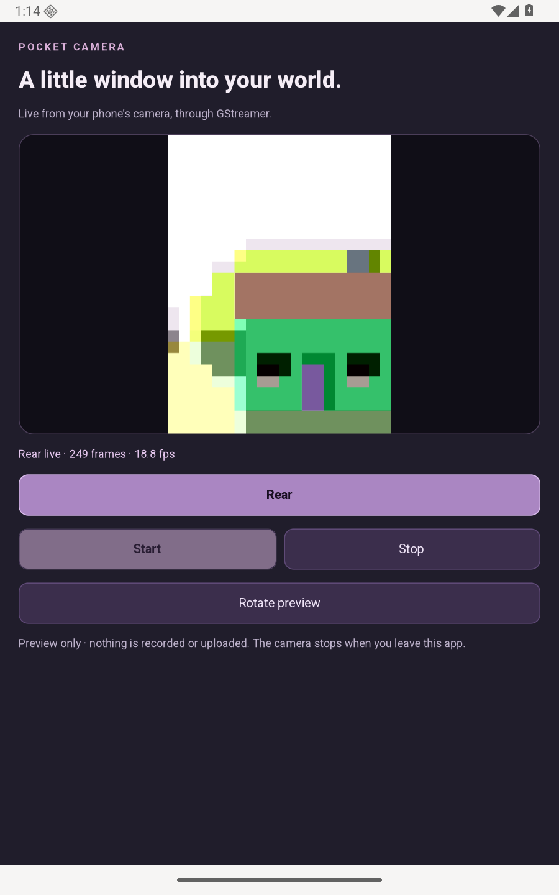

# Pocket Camera

Preview your phone's own front or rear camera in a GTK 4 app. SQGI constructs a
GStreamer pipeline and displays its frames in a `Gtk.Picture`.



## Run

After [setting up Android](../../docs/packaging/android.md), run from this folder:

```sh
./run.sh
```

For an Android 12+ phone with USB debugging enabled:

```sh
./run.sh --serial YOUR_DEVICE_SERIAL
```

Choose **Rear** or **Front** and tap **Start**. You can switch cameras during a
live preview. On the first run, allow camera access and
tap **Start** again. **Stop** releases the camera; leaving the app also stops
the preview. **Rotate preview** adjusts its orientation.

This is a live preview: it does not record, upload or request microphone access.
An emulator shows its configured virtual camera. A physical phone uses its own
camera hardware; the app never substitutes a test pattern.

## How it works

The manifest selects Ooblerg's Ubuntu 24.04 GStreamer packages from the Android catalog.
`sqgipkg` downloads their Android libraries, typelibs and required callback
classes for the selected ABI. It builds the shared [SqAndroid helper](../android-support/README.md)
for camera enumeration and permission requests.

`src/video.nut` creates this pipeline:

```text
ahcsrc → videoconvert → videoscale → RGBA 640×480 → appsink
```

The GTK timer pulls the latest available frame without blocking, converts it
to a GDK texture and updates the preview. This deliberately simple CPU-copy
path makes the GI calls easy to follow; it is not a zero-copy video renderer.
