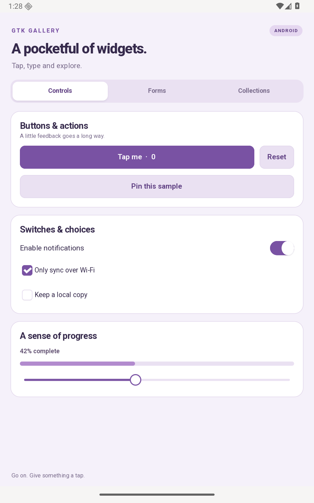
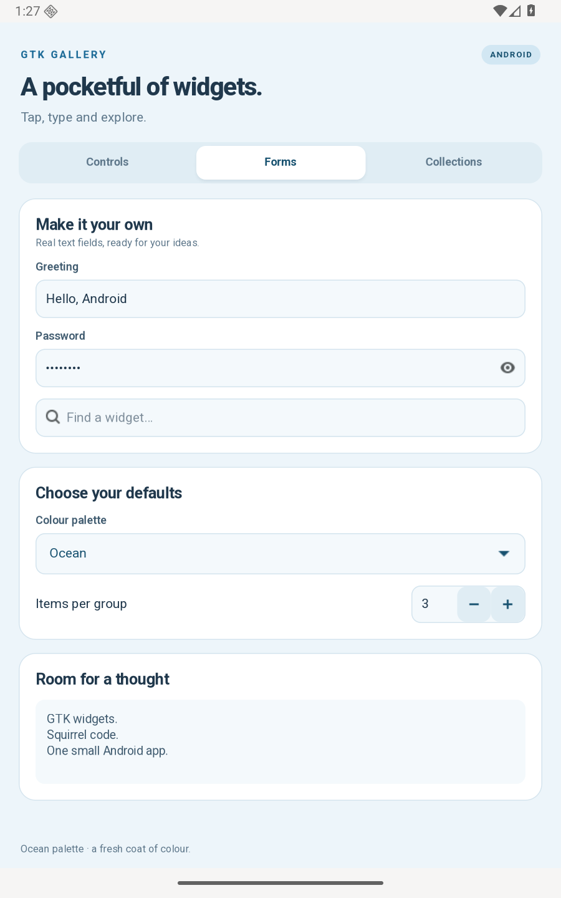

# GTK Widget Gallery

A touch-friendly tour of GTK 4 controls, forms and collections, written in SQGI.
Try the counter, switches, slider, text entry, colour selector, calendar and
expandable details. The colour palette on **Forms** changes the whole gallery:
Forest green, Ocean blue, warm Sunset or Lavender purple.





## Run

Prepare the Android tools once:

```sh
sqgipkg setup --platform android --emulator --accept-licenses
```

From this folder, run `./run.sh` to build and open the demo in the emulator.
For a connected Android 12+ phone with USB debugging enabled:

```sh
./run.sh --serial YOUR_DEVICE_SERIAL
```

Use `./run.sh --headless` for an emulator without a desktop window. See the
[Android setup guide](../../docs/packaging/android.md) for prerequisites.

The app needs no Android permissions. Edit `src/main.nut` and `src/style.css`,
then run `sqgipkg sync --platform android --serial SERIAL` to update a running
debug build.
