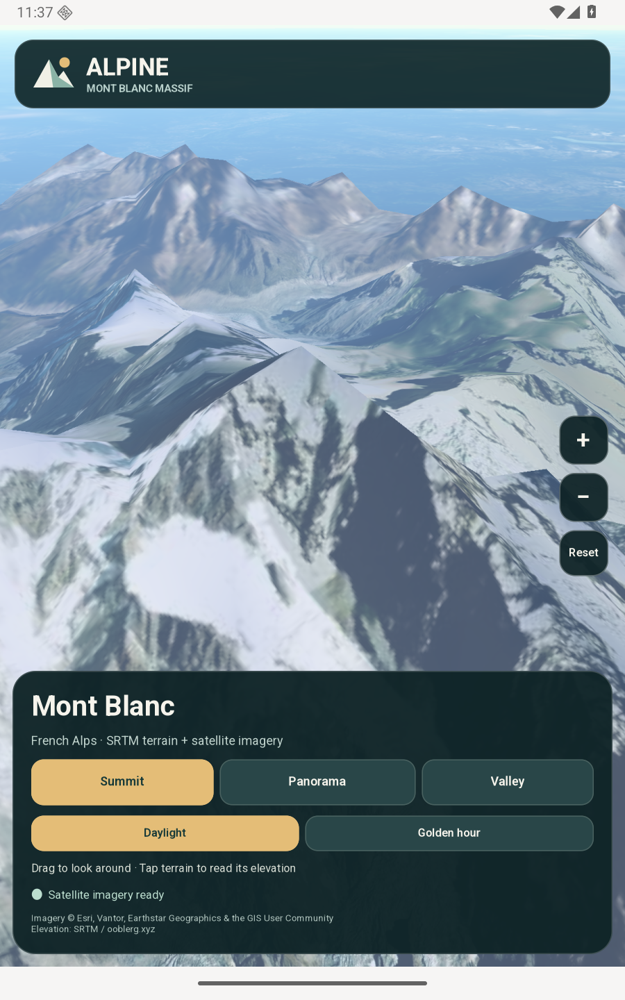
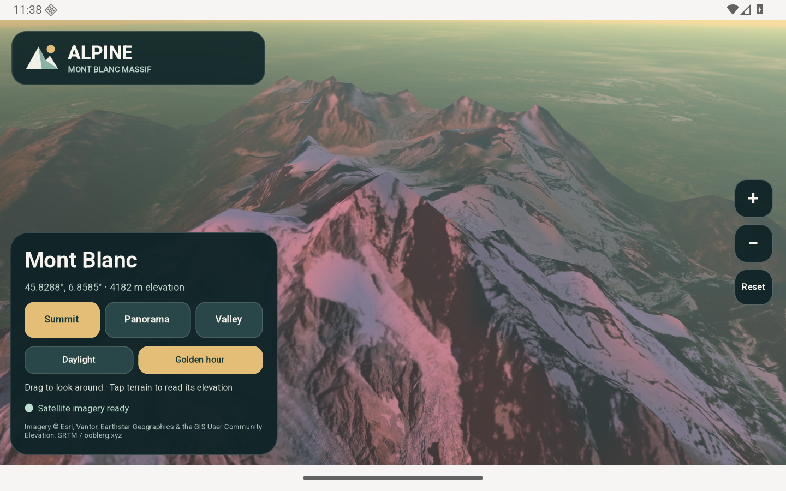
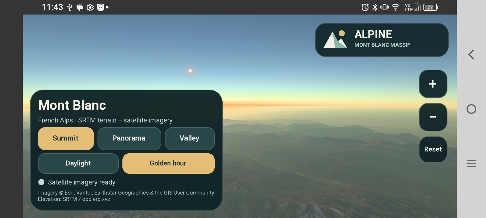

# Alpine

Explore Mont Blanc in 3D with real elevation and live satellite imagery.
Alpine is a Squirrel/GTK 4 Android app using GWorldScene through GObject
Introspection.





Screenshots captured from the Android emulator.



Also tested on a TCL 605 running Android 15, using its ARM64 runtime and GPU.

## Run on an emulator

On a Linux x86_64 host with SQGI installed, prepare the Android tools once:

```sh
sqgipkg setup --platform android --emulator --accept-licenses
```

Then run this demo:

```sh
./run.sh
```

The script starts the SQGI emulator, builds an x86_64 APK, installs it and opens
Alpine. Use `./run.sh --headless` to run the emulator without a window. See the
[Android setup guide](../../docs/packaging/android.md#first-app-on-ubuntu-2404)
for host prerequisites.

## Run on a phone

Enable USB debugging, connect the phone and accept its debugging prompt. Find
the serial with `adb devices`, then run:

```sh
./run.sh --serial YOUR_DEVICE_SERIAL
```

`sqgipkg` selects the phone's ABI. Android 12 or later and OpenGL ES 3 are
required. The app appears in the launcher as **Alpine**.

On Ubuntu, if ADB reports `no permissions` for a TCL phone, run
`./allow-phone-usb.sh`. It asks for your Ubuntu password and grants your account
USB access until the phone is unplugged. Then restart ADB with
`adb kill-server; adb start-server` and accept the phone's debugging prompt.

## Explore

- Choose **Summit**, **Panorama** or **Valley** for a different viewpoint.
- Drag the terrain to look around. Use **+** and **−** to change camera height.
- Tap the terrain to read its coordinates and elevation.
- Switch between **Daylight** and **Golden hour** to change the lighting.
- **Reset** restores the selected viewpoint. **Retry** reloads satellite imagery
  after a network failure.

The Mont Blanc elevation tile is bundled, so terrain is available offline.
Satellite imagery requires an Internet connection and is held in memory during
the session. The bundled elevation covers 45–46° N, 6–7° E.

## Build and edit

```sh
sqgipkg build --platform android --arch arm64-v8a
sqgipkg build --target android-aab
sqgipkg watch --platform android --serial YOUR_DEVICE_SERIAL
```

APKs and App Bundles are written under `dist-android*/`. The manifest selects
Ooblerg's `noble-android-r6` SDK and native packages for ARM64 and
x86_64. Edit `src/main.nut` for the interface, `src/world.nut` for viewpoints
and imagery, and `assets/style.css` for styling.

## Map sources

- Elevation: SRTM, supplied by [Ooblerg's terrain service](https://ooblerg.xyz/terrain/N45E006.hgt.zip).
  `assets/terrain/source.json` records the source and checksums. The raster has
  1201 × 1201 samples, with elevations in metres relative to EGM96.
- Imagery: [Esri World Imagery](https://services.arcgisonline.com/ArcGIS/rest/services/World_Imagery/MapServer).
  Attribution: Esri, Vantor, Earthstar Geographics and the GIS User Community.
  Change the XYZ tile URL in `src/world.nut` to use another imagery provider.
