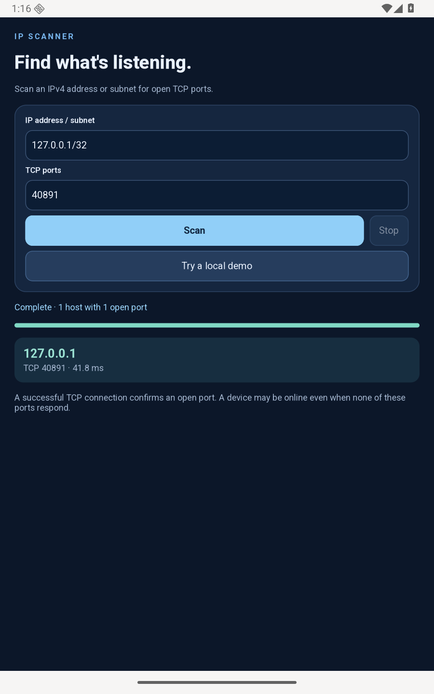

# IP Scanner

Find open TCP ports on an IPv4 address or small subnet using asynchronous Gio
connections. The GTK interface stays responsive while up to eight connections
run at once, each with a one-second timeout.



## Run

After [setting up Android](../../docs/packaging/android.md), run from this folder:

```sh
./run.sh
```

For an Android 12+ phone with USB debugging enabled:

```sh
./run.sh --serial YOUR_DEVICE_SERIAL
```

## Scan

Tap **Try a local demo** to start a temporary listener inside the app and scan
its loopback port. This works without another device or network connection.

To check your own network, enter an address such as `192.168.1.1` or a subnet
such as `192.168.1.0/24`, choose up to 16 comma-separated ports, and tap **Scan**.
The app accepts `/24` through `/32`; **Stop** cancels pending connections.

A result means the TCP connection succeeded. Devices can remain online while
their ports are closed or filtered. This demo does not identify operating
systems, send service requests or perform an ICMP ping sweep. It requests
Android's Internet permission, which also permits local network connections.

`src/scanner.nut` contains the reusable scanner. `src/main.nut` handles the UI
and the local demo listener.
