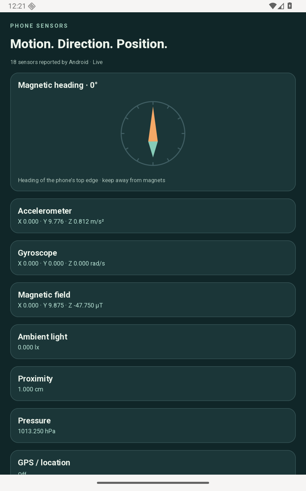
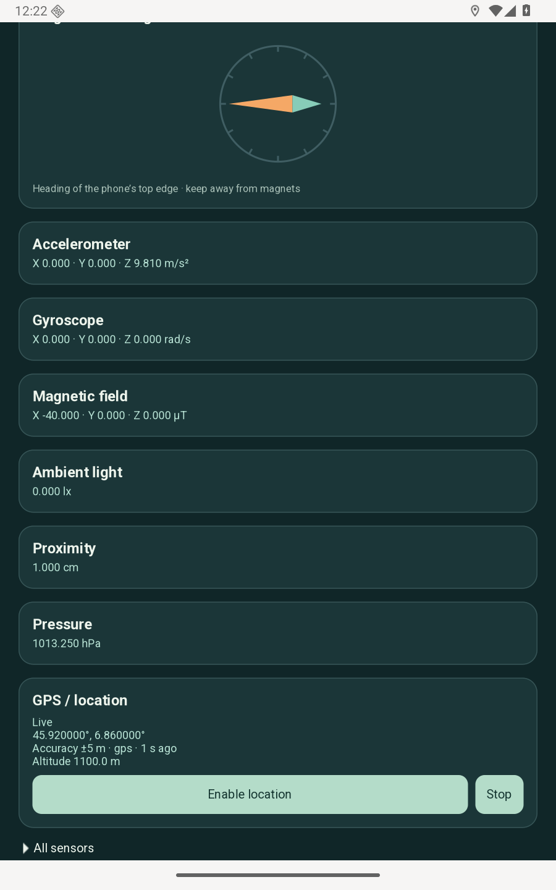

# Phone Sensors

Explore your phone's accelerometer, gyroscope, magnetic field, compass, light,
proximity, pressure and GPS/location. **All sensors** lists the sensors Android
reports, their vendor and resolution, and their latest readings.





## Run

After [setting up Android](../../docs/packaging/android.md), run from this folder:

```sh
./run.sh
```

For an Android 12+ phone with USB debugging enabled:

```sh
./run.sh --serial YOUR_DEVICE_SERIAL
```

The emulator provides simulated sensor values. A phone shows its actual
hardware; absent sensors are marked unavailable. One-shot sensors and formats
the demo cannot interpret remain listed with an explanatory state.

## Explore

Move the phone to change acceleration and angular velocity. Compass heading is
relative to magnetic north and the phone's physical top edge; it needs both
accelerometer and magnetometer readings. Keep the phone away from magnets.

Tap **Enable location** to request foreground location access. Android lets you
choose precise or approximate access. GPS may need a clear view of the sky;
the app displays the provider, accuracy and age of each fix. **Stop** ends
location updates and clears the displayed fix.

Sensor acquisition pauses when the app loses focus, and location updates stop
while it is in the background. Readings are neither saved nor transmitted.

## Native module

[SqAndroid](../android-support/README.md) provides C GObjects through GI.
`SqAndroid.Sensors` acquires readings through the NDK and calculates compass
headings in C. `SqAndroid.Device` connects to Android's location and permission
APIs through a private framework helper. The application itself is SQGI and GTK.
